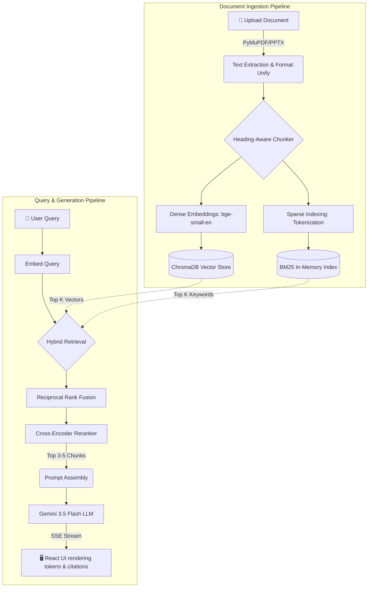

<div align="center">
  <h1>🎓 ScholarRAG</h1>
  <p><em>Advanced Hybrid Retrieval-Augmented Generation with Verifiable Citations</em></p>

  <p>
    
    
    
    
    
  </p>
</div>

---

## 📖 Executive Summary

**ScholarRAG** solves the inherent hallucination problem in Large Language Models by grounding generative responses entirely within your specific documents. Engineered for academics, legal professionals, and data-heavy researchers, it provides a seamless interface to upload complex documents and query them instantly.

Unlike standard RAG pipelines, ScholarRAG employs a **Hybrid Retrieval Strategy** backed by a **Cross-Encoder Reranker**, ensuring that the LLM is fed only the absolute highest-fidelity context. Every generated claim is mapped back to the source material with **verifiable page-level citations**.

---

## ✨ Core Features & Visual Breakdown

| Feature | Description | Technical Implementation |
| :--- | :--- | :--- |
| **Hybrid Search** | Fuses meaning and exact keywords. | `ChromaDB` (Dense) + `BM25Okapi` (Sparse) via Reciprocal Rank Fusion (RRF). |
| **Cross-Encoder** | Strict relevance filtering. | `BAAI/bge-reranker-base` dynamically re-orders results before LLM generation. |
| **Smart Chunking** | Preserves document hierarchy. | Custom **heading-aware parent-child recursive chunker** preserving logical boundaries. |
| **SSE Streaming** | Real-time AI interactions. | Native `fetch` with FastAPI `StreamingResponse` yielding tokens chunk-by-chunk. |
| **Premium UI** | Modern glassmorphism design. | React, TailwindCSS, Radix UI primitives, and dynamic animations. |

### Highlights
* **🧠 Hybrid Retrieval** — Combines dense vector search (`BGE Embeddings`) and sparse lexical search (`BM25`).
* **🔀 RRF Fusion** — Merges semantic and lexical retrieval results seamlessly.
* **🎯 Cross-Encoder Reranking** — Uses `BAAI/bge-reranker-base` to select the most relevant evidence chunks.
* **🤖 Gemini Generation** — Synthesizes accurate answers using retrieved document context via Google Gemini.
* **📑 Page-Level Citations** — Links answers directly back to specific document pages and chunk IDs.
* **⚡ Real-Time Streaming** — Uses Server-Sent Events (SSE) for instant, token-by-token response streaming.
* **🎨 Modern UI** — Built with React, TypeScript, Vite, TailwindCSS, Radix UI, and Lucide icons.
* **💾 Local-First Processing** — Parsing, embedding, indexing, and reranking run locally for data privacy.

---

## 🏗️ System Architecture Flow

The pipeline is heavily decoupled, separating the heavy machine learning inference tasks from the instantaneous web rendering tasks.



### Document Ingestion Flow

> **Upload** ➔ **Parse** ➔ **Chunk** ➔ **Embed** ➔ **ChromaDB + BM25**  
> *Every chunk retains metadata (document name, page number, chunk ID) ensuring traceability throughout retrieval and generation.*

---

## 🔬 Under the Hood: AI Models

ScholarRAG doesn't rely entirely on cloud APIs. It runs critical, privacy-centric models entirely on your local hardware for ingestion and retrieval:

1. **Embedding Layer (`BAAI/bge-small-en-v1.5`)**: 
   - A highly efficient, 384-dimensional dense model that requires < 500MB of RAM. Exceptional at grasping semantic relationships in English academic text.
2. **Reranking Layer (`BAAI/bge-reranker-base`)**: 
   - A Cross-Encoder. Instead of comparing two isolated vectors, it feeds the user query and the retrieved chunk through attention layers *simultaneously*, outputting a highly accurate 0.0–1.0 relevance score.
3. **Generative Layer (`gemini-3.5-flash`)**: 
   - Google's blazing-fast generative model, restricted by a rigid system prompt to only answer using provided context.

---

## 🛠️ Technology Stack

### Backend

| Component | Technology |
| --- | --- |
| **API Framework** | FastAPI + Uvicorn |
| **Database & ORM** | SQLite + SQLModel |
| **Vector Store** | ChromaDB |
| **Embeddings** | `BAAI/bge-small-en-v1.5` |
| **Sparse Search** | BM25Okapi |
| **Reranker** | `BAAI/bge-reranker-base` |
| **LLM Generation** | Google Gemini |
| **Document Parsers** | PyMuPDF (PDF), python-pptx (PPTX) |
| **Chunking** | LangChain Text Splitters |

### Frontend

| Component | Technology |
| --- | --- |
| **Framework** | React 18 |
| **Language** | TypeScript |
| **Build Tool** | Vite |
| **Styling** | TailwindCSS |
| **UI Library** | Radix UI + Lucide Icons |
| **State Management** | Zustand |
| **Streaming** | Server-Sent Events (SSE) |

---

## 📂 Supported Documents

* **PDF** (`.pdf`)
* **PPTX** (`.pptx`)
* **TXT** (`.txt`)

*Future support roadmap includes DOCX, Markdown, scanned PDFs via OCR, tables, figures, and extraction tools.*

---

## 🚀 Setup & Installation Guide

### Prerequisites
- **Python 3.11+**
- **Node.js 18+**
- **Google Gemini API Key** ([Get it here](https://aistudio.google.com/))

### 1. Backend Initialization (FastAPI)

Clone the repository and set up your Python environment:

```bash
git clone https://github.com/shreemsri/academicRag.git
cd academicRag

# Create and activate virtual environment
python -m venv venv

# Windows
venv\Scripts\activate

# Linux/macOS
source venv/bin/activate

# Install dependencies
pip install -r backend/requirements.txt
```

Create your `.env` configuration file in the project root:

```ini
# .env
DEFAULT_LLM_PROVIDER=gemini
GEMINI_API_KEY=your_secure_api_key_here
```

Boot the server:
```bash
uvicorn backend.app.main:app --host 0.0.0.0 --port 8001
```
*(Note: Initial startup will dynamically download the BAAI models from HuggingFace to your local cache).*

### 2. Frontend Initialization (React)

Open a secondary terminal:

```bash
cd frontend
npm install
npm run dev
```

Navigate to `http://localhost:5174` in your browser. You are now ready to upload and query!

---

## 📁 Repository Structure

<details open>
<summary>Click to collapse directory tree</summary>

```text
academicRag/
├── backend/                  
│   ├── app/
│   │   ├── api/              # FastAPI Router endpoints
│   │   ├── core/             # Auth, Settings, Logging
│   │   ├── db/               # SQLite DB schemas and ChromaDB initialization
│   │   ├── ingestion/        # Document Parsing, Heading-Aware Chunkers
│   │   ├── retrieval/        # Dense (Vector) and Sparse (BM25) engines
│   │   ├── generation/       # Streaming LLM Interface (Gemini, OpenAI, Ollama)
│   │   └── main.py           # Application Entrypoint
│   └── requirements.txt      
│
├── frontend/                 
│   ├── src/
│   │   ├── components/       # Radix UI and custom glassmorphism components
│   │   ├── lib/              # Zustand stores, SSE fetch utilities
│   │   ├── App.tsx           
│   │   └── main.tsx          
│   ├── package.json          
│   └── tailwind.config.js    
│
├── .env                      # Secret Keys
├── documentation.md          # PDF Generator source
├── ScholarRAG_Documentation.pdf
├── test_upload.py
└── test_qa.py
```
</details>

---

## 🧪 Automated Testing

ScholarRAG ships with testing scripts to validate the pipeline:

- **`test_upload.py`**: Simulates the ingestion flow. Validates text extraction, chunking math, and ChromaDB vector commits.
- **`test_qa.py`**: Exercises the retrieval mechanisms (RRF math, cross-encoder scores) and verifies the SSE stream structure from Gemini.

Execute them directly:
```bash
# Test document ingestion pipeline
python test_upload.py

# Test retrieval and QA pipeline
python test_qa.py
```

---

## 🎯 Example Questions

After uploading a research paper or document, you can ask:

* What problem does this paper address?
* What methodology was used?
* What datasets were used?
* What are the major limitations?
* Summarize the experimental results.
* Which page discusses the evaluation methodology?

---

## 🔐 Reliability & Security

ScholarRAG reduces unsupported answers through a rigorous multi-stage pipeline:

$$\text{Hybrid Retrieval} \longrightarrow \text{RRF Fusion} \longrightarrow \text{Reranking} \longrightarrow \text{Evidence Selection} \longrightarrow \text{Grounded Generation} \longrightarrow \text{Source Citation}$$

> *Note: RAG does not guarantee zero hallucinations; always verify citations against the original document.*

For production deployments, be sure to configure robust authentication, file size/type validation, rate limiting, secure secret management, CORS configuration, and upload isolation.

---

## 🔮 Future Roadmap

* [ ] OCR and scanned-PDF support
* [ ] Table and figure extraction
* [ ] Multi-document comparison views
* [ ] Literature review assistance tools
* [ ] Citation graph visualization
* [ ] Research-gap detection engine
* [ ] DOCX and Markdown support
* [ ] Retrieval and citation evaluation metrics
* [ ] Collaborative research workspaces

---

## ⭐ Project Summary

ScholarRAG combines dense retrieval, sparse BM25 search, RRF fusion, cross-encoder reranking, Gemini generation, SSE streaming, and page-level citations into a single academic research assistant.

Turn your documents into an interactive, searchable, evidence-grounded research knowledge base.

---

<div align="center">
  <p>Built for the future of academic research. 🚀</p>
</div>
