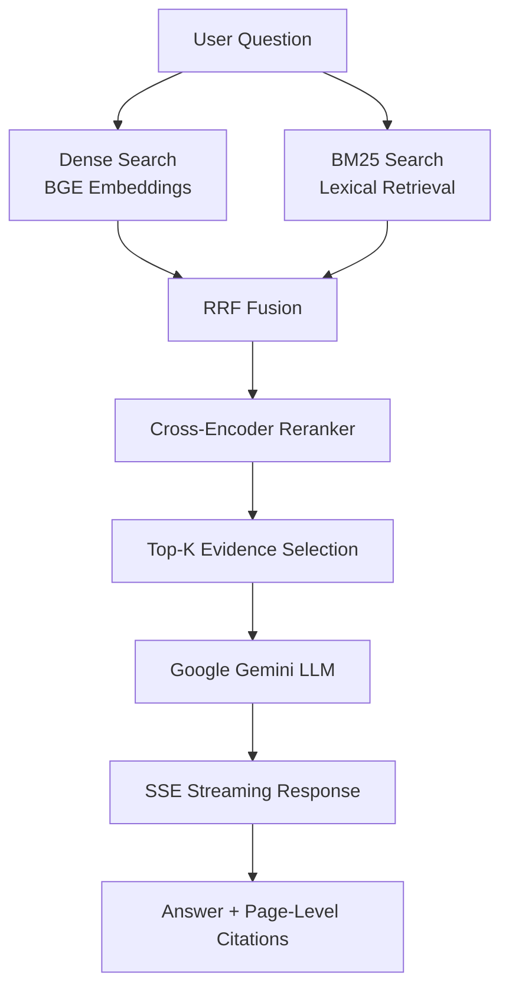

# 🎓 ScholarRAG

### Academic Retrieval-Augmented Generation for Intelligent Document Research

**ScholarRAG** is a local-first hybrid RAG platform designed to parse, index, and analyze academic papers, technical documentation, and professional reports with verifiable page-level citations.

---

## ✨ Key Features

* **🧠 Hybrid Retrieval** — Combines dense vector search (`BGE Embeddings`) and sparse lexical search (`BM25`).
* **🔀 RRF Fusion** — Merges semantic and lexical retrieval results seamlessly.
* **🎯 Cross-Encoder Reranking** — Uses `BAAI/bge-reranker-base` to select the most relevant evidence chunks.
* **🤖 Gemini Generation** — Synthesizes accurate answers using retrieved document context via Google Gemini.
* **📑 Page-Level Citations** — Links answers directly back to specific document pages and chunk IDs.
* **⚡ Real-Time Streaming** — Uses Server-Sent Events (SSE) for instant, token-by-token response streaming.
* **🎨 Modern UI** — Built with React, TypeScript, Vite, TailwindCSS, Radix UI, and Lucide icons.
* **💾 Local-First Processing** — Parsing, embedding, indexing, and reranking run locally for data privacy.

---

## 🏗️ Architecture



### Document Ingestion Flow

> **Upload** ➔ **Parse** ➔ **Chunk** ➔ **Embed** ➔ **ChromaDB + BM25**
> *Every chunk retains metadata (document name, page number, chunk ID) ensuring traceability throughout retrieval and generation.*

---

## 🛠️ Technology Stack

### Backend

| Component | Technology |
| --- | --- |
| **API Framework** | FastAPI + Uvicorn |
| **Database & ORM** | SQLite + SQLModel |
| **Vector Store** | ChromaDB |
| **Embeddings** | `BAAI/bge-small-en-v1.5` |
| **Sparse Search** | BM25Okapi |
| **Reranker** | `BAAI/bge-reranker-base` |
| **LLM Generation** | Google Gemini |
| **Document Parsers** | PyMuPDF (PDF), python-pptx (PPTX) |
| **Chunking** | LangChain Text Splitters |

### Frontend

| Component | Technology |
| --- | --- |
| **Framework** | React 18 |
| **Language** | TypeScript |
| **Build Tool** | Vite |
| **Styling** | TailwindCSS |
| **UI Library** | Radix UI + Lucide Icons |
| **State Management** | Zustand |
| **Streaming** | Server-Sent Events (SSE) |

---

## 📂 Supported Documents

* **PDF** (`.pdf`)
* **PPTX** (`.pptx`)
* **TXT** (`.txt`)

*Future support roadmap includes DOCX, Markdown, scanned PDFs via OCR, tables, figures, and extraction tools.*

---

## 🚀 Getting Started

### Prerequisites

* Python 3.11 or 3.12
* Node.js 18+ and npm
* A valid Google Gemini API Key

### 1. Clone Repository

```bash
git clone https://github.com/shreemsri/academicRag.git
cd academicRag

```

### 2. Configure Environment Variables

Create a `.env` file in the root directory:

```env
DEFAULT_LLM_PROVIDER=gemini
GEMINI_API_KEY=your_gemini_api_key_here

```

### 3. Setup Backend

```bash
python -m venv venv

# Windows
venv\Scripts\activate

# Linux/macOS
source venv/bin/activate

pip install -r backend/requirements.txt

# Start FastAPI server
uvicorn backend.app.main:app --host 0.0.0.0 --port 8001

```

> *Backend runs at **http://localhost:8001***

### 4. Setup Frontend

Open a separate terminal window:

```bash
cd frontend
npm install
npm run dev

```

> *Open the local Vite URL shown in the terminal, typically **http://localhost:5174***
> *(Note: On first startup, Hugging Face embedding and reranking models will be downloaded automatically).*

---

## 🧪 Testing

Test document ingestion pipeline:

```bash
python test_upload.py

```

Test retrieval and QA pipeline:

```bash
python test_qa.py

```

---

## 📁 Project Structure

```text
academicRag/
├── backend/
│   ├── app/
│   └── requirements.txt
├── frontend/
│   ├── src/
│   └── package.json
├── tests/
├── test_upload.py
├── test_qa.py
├── .env
└── README.md

```

---

## 🎯 Example Questions

After uploading a research paper or document, you can ask:

* What problem does this paper address?
* What methodology was used?
* What datasets were used?
* What are the major limitations?
* Summarize the experimental results.
* Which page discusses the evaluation methodology?

---

## 🔐 Reliability & Security

ScholarRAG reduces unsupported answers through a rigorous multi-stage pipeline:


$$\text{Hybrid Retrieval} \longrightarrow \text{RRF Fusion} \longrightarrow \text{Reranking} \longrightarrow \text{Evidence Selection} \longrightarrow \text{Grounded Generation} \longrightarrow \text{Source Citation}$$

> *Note: RAG does not guarantee zero hallucinations; always verify citations against the original document.*

For production deployments, be sure to configure robust authentication, file size/type validation, rate limiting, secure secret management, CORS configuration, and upload isolation.

---

## 🔮 Future Roadmap

* [ ] OCR and scanned-PDF support
* [ ] Table and figure extraction
* [ ] Multi-document comparison views
* [ ] Literature review assistance tools
* [ ] Citation graph visualization
* [ ] Research-gap detection engine
* [ ] DOCX and Markdown support
* [ ] Retrieval and citation evaluation metrics
* [ ] Collaborative research workspaces

---

## ⭐ Project Summary

ScholarRAG combines dense retrieval, sparse BM25 search, RRF fusion, cross-encoder reranking, Gemini generation, SSE streaming, and page-level citations into a single academic research assistant.

Turn your documents into an interactive, searchable, evidence-grounded research knowledge base.

---